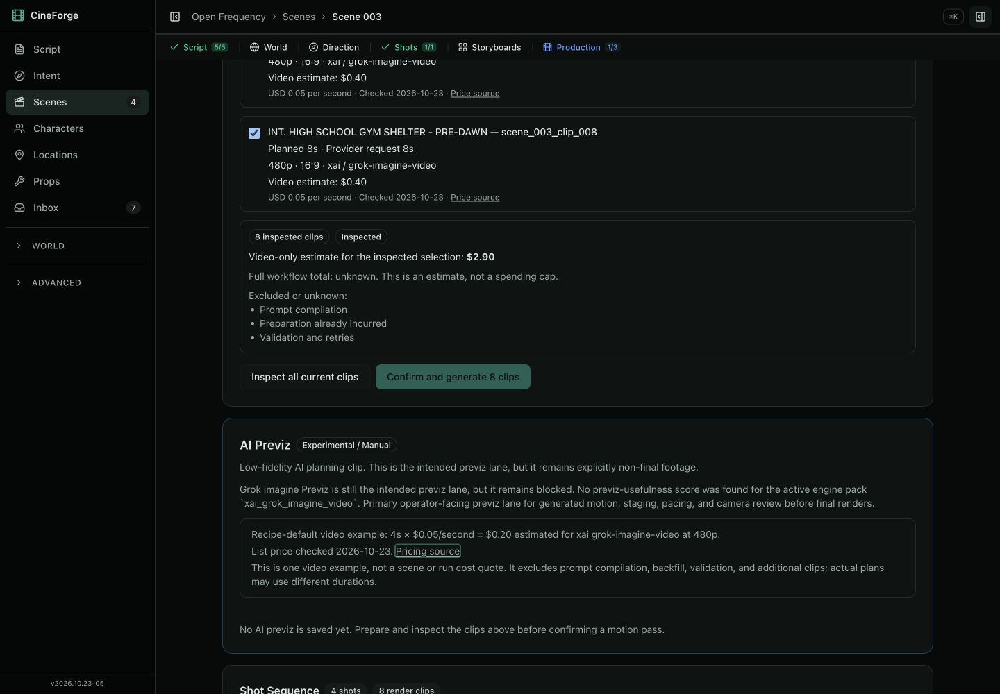
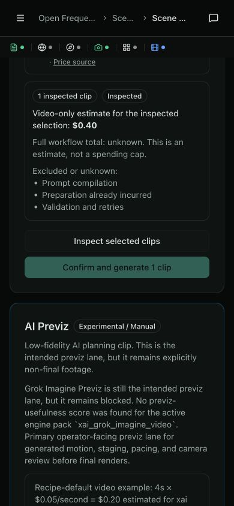
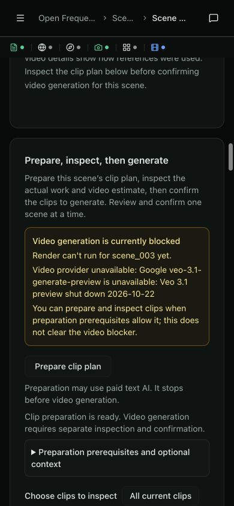

# UI Scout — 2026-10-24 — Open Frequency media inspection

**Scenario:** FP1 partial continuation, not a new full-pipeline pass.
**Story:** 234; full downstream acceptance remains owned by blocked232.
**Environment:** isolated `codex/triage-20261024` at baseb6fe8319 with uncommitted changes; API8002/UI5176 using the normally created primary `output/open-frequency` project. API was cleanly restarted after backend changes. UI dependencies are isolated. No copied or seeded artifact state.
**Result:** current-scene preparation, inspection, subset selection and honest blocked confirmation pass on desktop1440×1000/mobile390×844. No live video generated. Last full FP1 Pass remains2026-04-12.

## Observed path and output

- Continued the normal intake project from run-fae39865. Surfaced scene1 Previz preparation ran timeline, tracks, shot planning and render-clip planning, stopping before video: 7clips/48seconds. Scene2 Render preparation likewise stopped before video. Both initially crashed the browser on the completion transition; retained failures are linked below.
- After the targeted Radix Slot repair, repeated preparation of existing scene2 did no AI work and successfully inspected current clips. This empty selected interval is not fresh-transition evidence.
- Fresh scene3 Previz preparation `run-70ed8443`, with chat visible, completed the four planning stages and automatically inspected8clips/58seconds without a console error. The plan follows the source shelter scene's flyer/dog conversation and radio update in order; the inspected clip IDs/durations match the stored plan. These are inspected planning artifacts, not video-quality evidence.
- All scene3 previz clips showed actual480p xAI requests of8,7,7,6,8,6,8,8seconds and a sourced USD2.90 video-only estimate. Full workflow total remains unknown, with preparation, compilation, validation and retries excluded.
- On mobile, Clear selection disabled inspection/confirmation. Selecting clip001 and inspecting produced one8-second request, USD0.40. Changed selection invalidates the previous review. No horizontal overflow (document width390).
- Render inspection on the same scene normalized all eight requests to8seconds at720p and showed Unknown video price plus the existing retired Veo preview blocker. The provider blocker is visible before the potentially paid preparation action.
- Current clip cards remain visible, show missing media honestly, and route through Review Clip to Generate. Previously saved/historical/single-clip consumer behavior is also covered by focused tests; no saved playable output exists in this normal project, so playback is not claimed here.
- Confirm remained disabled for missing xAI credentials or the retired Render target. The successful confirmation path was independently exercised through real API → worker → driver → adapter → persistence with only the video generator stubbed; that is mechanical evidence, not browser/live-provider acceptance.

## Failure and repair

Two real completion transitions failed with React Maximum update depth exceeded. A frozen-code repeat disproved the initial HMR explanation. The active Tooltip/Popper/Slot path used Radix Slot1.2.3's render-time composed ref. The official Slot1.2.5 repair was applied through a narrow pnpm override and isolated dependencies. A small standalone fixture did not reproduce the original fault; it is not counted as proof. The later fresh scene3 transition is the local applicability evidence, and cannot guarantee every possible React transition is fixed.

Sources and full dispositions: [review findings](../reports/story-234/review-findings.md). Original errors remain in [browser-failures.json](../reports/story-234/browser-failures.json); post-fix console has zero warnings/errors since04:08UTC in [console-after-fix.json](../reports/story-234/console-after-fix.json). Temporary viewport override was reset. Primary package/workspace/lock hashes are unchanged in the before/after receipts.

## Costs and limits

Recorded preparation estimates: scene1 USD0.2713494; scene2 USD0.2312416; existing-scene repeat USD0; fresh scene3 USD0.2800328. Total USD0.7826238. These are application estimates, not invoices, and exclude Codex agent use and prior intake. No video call, new credential, model adoption, price refresh or media-quality evaluation occurred. Existing maintained text models were used. xAI was deliberately unavailable in the validation server; the previous credential-rotation requirement is not cleared by this run.

Manual output inspection also observed pre-existing planning limitations: scene1 shot-plan dialogue order differs from screenplay order while its clip plan restores order (model-wrong, non-runtime-blocking for this approval boundary); scene3 coverage prose says three shots while four are produced (model-wrong, non-runtime-blocking here). These do not warrant a quality score or a model promotion. The inherited scene-location PRE-DAWN parsing artifact was retained rather than rewritten in place.

## Evidence and optional verification

[Exact run/artifact hashes and plan values](../reports/story-234/normal-workflow-evidence.json).

Open `/open-frequency/scenes/scene_003?tab=previz`: inspect current clips, clear/select one clip, inspect again. Render exposes its provider blocker on the same scene. Do not treat this report as authorizing a live video call or certifying FP1 success.

## October25 closeout continuation

Final paused/no-op fixes were verified through the normal project. Temporarily lowered project budget from5to0.01 through settings API, then used surfaced scene4 Prepare. run-5ce1495e paused before the first stage with historical baseline0.8635632, no attempts/calls and zero new cost. The UI correctly said paused, did not auto-inspect unfinished work, and opened the existing run screen with Resume controls. Restored budget5 immediately; did not resume. All provider credentials were disabled on the restarted test server. Desktop/mobile screenshots and state receipt are in story234 reports. Existing scene3 plan inspected directly without a new preparation job; final console has no warnings/errors and viewport was reset. This extends only the scoped control proof, not FP1 or provider quality.
